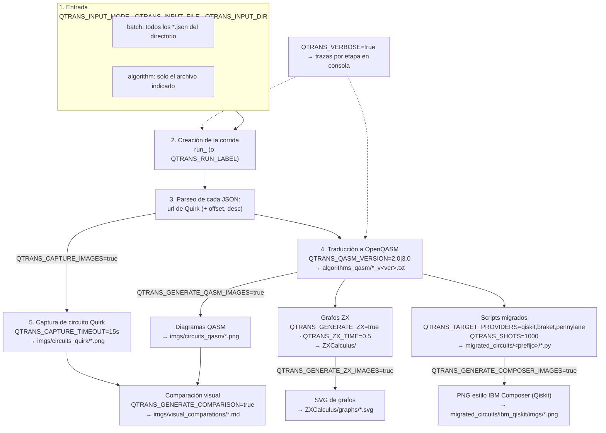

# QTransLIFIA

QTransLIFIA traduce circuitos cuánticos desde [Quirk](https://algassert.com/quirk) a cualquier ecosistema objetivo de desarrollo cuántico (actualmente: [IBM Qiskit](https://www.ibm.com/quantum/qiskit), [AWS Braket](https://aws.amazon.com/braket/getting-started/) o [Xanadu Pennylane](https://pennylane.ai/codebook/pennylane-fundamentals)) utilizando como lenguaje "pivote" de representación intermedia a [OpenQASM](https://openqasm.com/language/standard_library.html).

Desde la perspectiva de la _Ingeniería de Software Cuántica (QSE)_, **QTransLIFIA** se concibe con atributos de calidad explícitos: **abstracción** y **expresividad** (preservación semántica de las *custom gates* definidas en Quirk), **verificabilidad** y **testing** (equivalencia estructural y por cálculo ZX entre el circuito diseñado y el migrado, con estrategias de comprobación en cada etapa del flujo), así como **escalabilidad** y **extensibilidad** (crecimiento hacia nuevos ecosistemas sin reescribir el núcleo). Estos seis atributos se documentan de forma individual y se recopilan en la [**subsección de documentación del proyecto**](doc/QTransLIFIA_QSE.md).

## Flujos de ejecución
El proyecto ofrece **dos formas de ejecución**, independientes entre sí pero con el mismo flujo funcional y la misma estructura de archivos de entrada y salida:

| Modo | Punto de entrada | Entrada (default) | Salida (default) | Recomendado para |
| --- | --- | --- | --- | --- |
| **Librería Python** | `qtrans` (paquete: CLI + API) | `input/` | `output/run_DD_MM_YYYY__HH/` | Automatización, scripts, integración en otros flujos |
| **Cuaderno Jupyter** | `notebooks/QTrans.ipynb` | `input/` | `output/run_DD_MM_YYYY__HH/` | Exploración, visualización y demostraciones |

> En **ambos modos** `input/` y `output/` se resuelven en la **raíz del proyecto**. El cuaderno lo hace a partir de su propia ubicación (`qtrans/core.py`), por lo que funciona aunque se ejecute desde otra carpeta.

Ambos modos comparten: lectura de JSON con URLs de Quirk, traducción a OpenQASM como lenguaje representacional intermedio, visualización (mediante capturas PNG, diagramas, comparaciones), grafos ZX y generación de scripts migrados.

Las tres vías de ejecución —**API de librería** (`translate_circuit`), **CLI/pipeline** (`run_pipeline` / `python -m qtrans`) y **cuaderno**— comparten **una única lógica** implementada en `qtrans/utils` (traducción Quirk→OpenQASM, carga de OpenQASM, migración a proveedores y verificación ZX), de modo que no existen variantes contradictorias entre ellas.

## Estructura del proyecto

```text
.
├── input/                                # JSON de entrada (librería/CLI y cuaderno)
├── output/                               # Corridas de ambos modos (no versionado)
│   └── run_<estampa>/                    # Una carpeta por corrida
├── notebooks/
│   └── QTrans.ipynb                      # Cuaderno con la lógica del pipeline
├── qtrans/                               # Paquete instalable
│   ├── __init__.py                       # API pública: translate_circuit, run_pipeline, main
│   ├── __main__.py                       # Soporte para `python -m qtrans`
│   ├── core.py                           # Pipeline, CLI y API del pipeline
│   └── utils/
│       ├── __init__.py
│       ├── qutils.py                     # Fachada de compatibilidad (reexporta todo)
│       ├── qasm_utils.py                 # Utilidades de OpenQASM (tablas, ángulos, versiones)
│       ├── quirk_utils.py                # Traducción Quirk/OpenQASM, capturas y comparación
│       ├── provider_utils.py             # Registro de proveedores y dispatch de migración
│       ├── qiskit_utils.py               # Qiskit (IBM): parser, diagramas y scripts
│       ├── braket_utils.py               # AWS Braket
│       ├── pennylane_utils.py            # Xanadu PennyLane
│       ├── zx_utils.py                   # Grafos ZX (PyZX) desde Quirk y OpenQASM
│       ├── url_utils.py                  # Parseo/encodeo de URLs Quirk + extracción Postman
│       ├── main.py
│       └── cleanup_outputs.py            # Limpieza de las corridas de salida
├── test/                                 # Directorio de pruebas funcionales
│   ├── test_qtrans.py                    # Pruebas del pipeline/CLI
│   ├── test_qasm.py                      # Pruebas de traducción OpenQASM (script manual)
│   ├── test_translate.py                 # Pruebas del contrato de la API translate_circuit
│   ├── test_translate_circuits.py        # Pruebas de la API de objetos translate_circuits
│   ├── test_translate_lib.py             # Ejemplo imprimible de translate_circuit (script manual)
│   ├── test_providers.py                 # Pruebas de migración por proveedor
│   ├── test_matrix_customs.py            # Pruebas de las compuertas custom con 'matrix'
│   ├── test_endianness.py                # Pruebas de convención de endianness
│   ├── test_xy_probes.py                 # X/Y Probes y post-selecciones de Quirk
│   ├── test_qft_canonical.py             # Canonicidad de QFT†n y regresión sobre input/
│   └── test_url_utils.py                 # Normalización y canonicalización de URLs
├── tools/                                # Baterías de verificación ejecutables
│   ├── check_static.py                   # Análisis estático (AST): nombres no definidos e imports muertos
│   ├── verify_matrix_gates.py            # Fidelidad numérica de las compuertas custom con 'matrix'
│   ├── verify_backend_equivalence.py     # Equivalencia entre el parser nativo y el script migrado
│   └── migrate_circuit.py                # Migración aislada de un circuito (JSON en consola)
├── qtrans_demo/                          # Subproyecto aislado: consume qtranslifia desde demo_venv
├── doc/                                  # Documentación QSE y paper (qtrans.tex)
├── pyproject.toml                        # Empaquetado (pip install)
├── requirements.txt                      # Librerías requeridas
└── original/                             # Librerías originales heredadas
```

### Salidas: directorio de corrida (`run_<estampa_fecha_hora>`)

En **ambos modos** todas las salidas se agrupan bajo un único directorio de corrida en la **raíz del proyecto** (`output/`), donde `<estampa_fecha_hora>` codifica la fecha y la hora de inicio. La única diferencia entre modos es el formato de la estampa:

- **Librería/CLI** → `output/run_DD_MM_YYYY__HH/` (fecha y hora **con hora, sin minutos**, p. ej. `run_10_10_2026__13`), configurable con `QTRANS_OUTPUT_DIR`. La resolución es **por hora**: dos ejecuciones dentro de la misma hora reutilizan la misma carpeta y **sobrescriben** sus archivos (los artefactos de la corrida previa se regeneran), de modo que en `output/` no se acumulan carpetas `run_*`.
- **Cuaderno** → `output/run_DD_MM_YYYY__HH/` (misma resolución por hora). El cuaderno resuelve la raíz del proyecto a partir de su propia ubicación, por lo que **siempre** escribe en `output/` aunque se ejecute desde otra carpeta.

Las entradas también viven en la raíz del proyecto (`input/`) en ambos modos.

Dentro de la corrida la estructura es idéntica:

```text
run_<estampa_fecha_hora>/
├── algorithms_qasm/            # OpenQASM traducido (*.txt con sufijo _v<version>)
├── imgs/                       # Directorio para comparación e información visual
│   ├── circuits_quirk/         # Capturas PNG de los circuitos Quirk originales
│   ├── circuits_qasm/          # Diagramas PNG de los circuitos OpenQASM
│   └── visual_comparations/    # Informes Markdown de comparación Quirk/QASM
├── migrated_circuits/          # Scripts Python migrados por ecosistema
│   ├── ibm_qiskit/
│   │   └── imgs/               # PNG estilo IBM Quantum Composer
│   ├── aws_braket/
│   ├── xanadu_pennylane/
|   └── ... otros               # otros a futuro ...
└── ZXCalculus/                 # Equivalencia de circuitos utilizando cálculo ZX
    ├── algorithms_base/        # Grafos ZX construidos desde Quirk (*.json)
    ├── algorithms_qasm/        # Grafos ZX construidos desde OpenQASM (*.json)
    ├── graphs/                 # Diagramas SVG de los grafos
    └── comparison_results.md   # Resultados de equivalencia (tabla Markdown)
```

- Ejecutar el flujo varias veces **dentro de la misma hora** reutiliza el mismo directorio y **sobrescribe** los archivos generados, evitando crear una carpeta nueva por cada reintento.
- Al cambiar la hora se crea una nueva carpeta `run_*`, preservando el historial de corridas anteriores.
- Las carpetas generadas están excluidas del control de versiones (`.gitignore`: `/output/`, y `/notebooks/output/` por compatibilidad con corridas antiguas). Por cuestión de optimización y tamaño del proyecto, por lo cual no existe trazabilidad a nivel de ejecuciones en el repositorio GitHub.
- Además se provee un script para limpieza de directorios de salida en `qtrans/utils/cleanup_outputs.py`.

### Versión de OpenQASM

Tanto la librería/CLI como el cuaderno leen `QTRANS_QASM_VERSION` desde `.env` (`2.0` o `3.0`, por defecto `3.0`). Cada archivo OpenQASM se escribe con el sufijo de versión, por ejemplo `1__Shor_v3.0.txt` o `1__Shor_v2.0.txt`, lo que permite que ambas versiones coexistan en la misma corrida. Las etapas posteriores (imágenes, grafos ZX y migración) procesan **solo** los `.txt` de la versión activa (filtran por el sufijo) y quitan el sufijo al derivar sus nombres, de modo que sus artefactos conservan el nombre sin versión.

Esta doble funcionalidad de versiones se admite en principio ya que algunos ecosistemas utilizan de forma nativa la carga desde la versión 2.0 de OpenQASM. A futuro podría configurarse la parametrización como `latest` y que siempre obtenga la más reciente versión de OpenQASM.

## Instalación

Se recomienda Python 3.12, que es la versión usada en el entorno de desarrollo.

```bash
python -m venv .venv

# Windows PowerShell
.venv\Scripts\Activate.ps1
# macOS / Linux
source .venv/bin/activate

python -m pip install -r requirements.txt
```

Para capturar circuitos Quirk (parametrización: `QTRANS_CAPTURE_IMAGES`) como PNG se necesita Chrome o Chromium disponible en el equipo. Selenium inicia el navegador en modo headless.

## Entrada: formato JSON

Coloca en el directorio de entrada `input/` de la **raíz del proyecto** (compartido por la librería/CLI y el cuaderno) uno o más archivos `.json` que compondrán la batería de pruebas a abarcar por parte de la librería de migración. Cada archivo debe ser un objeto cuyas claves son nombres de algoritmos y cuyos valores incluyen una URL de Quirk:

```json
{
	"1. Ejemplo": {
		"url": "https://algassert.com/quirk#circuit=...",
		"offset": 0,
		"desc": "Descripción opcional"
	}
}
```

- `url` es obligatorio; `offset` y `desc` son opcionales.
- El modo batch procesa los JSON del **primer nivel** del directorio (no busca recursivamente).
- Si el nombre del archivo es `popular_algorithms.json`, los nombres de salida llevan el prefijo `popular_`.

Los parámetros: `QTRANS_INPUT_MODE`=(batch | algorithm) toman aquí especial relevancia, además si se configura la funcionalidad como "algorithm", es decir, un único algoritmo, se debe además configurar el parámetro: `QTRANS_INPUT_FILES`, que admite una lista de archivos .json con circuitos individuales.

## Configuración (`.env`)

Ambos modos cargan `.env` desde la raíz del proyecto (`load_dotenv()`). Plantilla base: `.env.example` (cópiala como `.env` para configuración local). Todas las rutas relativas se resuelven desde la raíz del proyecto.

Un ejemplo de configuración aceptada sería:
```dotenv
QTRANS_INPUT_MODE=algorithm
QTRANS_INPUT_FILE=test_quirk.json
QTRANS_INPUT_FILES=
QTRANS_INPUT_DIR=input
QTRANS_OUTPUT_DIR=output
QTRANS_RUN_LABEL=DD_MM_YYYY__HH
QTRANS_CAPTURE_IMAGES=true
QTRANS_GENERATE_QASM_IMAGES=true
QTRANS_GENERATE_COMPARISON=true
QTRANS_GENERATE_COMPOSER_IMAGES=true
QTRANS_GENERATE_ZX=true
QTRANS_GENERATE_ZX_IMAGES=true
QTRANS_VERBOSE=true
QTRANS_QASM_VERSION=3.0
QTRANS_ZX_TIME=0.5
QTRANS_SHOTS=1000
QTRANS_CAPTURE_TIMEOUT=15
QTRANS_TARGET_PROVIDERS=qiskit
QTRANS_PRESERVE_CUSTOM_GATES=true
```

| Variable | Utilización | Default |
| --- | --- | --- |
| `QTRANS_INPUT_MODE` | `batch` procesa los JSON del directorio (restringible con `QTRANS_INPUT_FILES`); `algorithm` procesa un solo archivo. | `batch` |
| `QTRANS_INPUT_FILE` | Archivo JSON seleccionado en modo `algorithm`; puede pasarse también por CLI. | |
| `QTRANS_INPUT_FILES` | Lista separada por comas de JSON (relativos a `QTRANS_INPUT_DIR`) que restringe el modo `batch` a esos archivos; también por CLI con `--input-files`. | _(vacío)_ |
| `QTRANS_INPUT_DIR` | Directorio de JSON de entrada. | `input` |
| `QTRANS_OUTPUT_DIR` | Raíz de las corridas (dentro se crea `run_<estampa>`). | `output` |
| `QTRANS_RUN_LABEL` | Etiqueta explícita de la corrida. Vacío = automático `DD_MM_YYYY__HH` (resolución por hora). | _(vacío)_ |
| `QTRANS_CAPTURE_IMAGES` | Activa capturas PNG de Quirk. Booleano (`true/false`, `yes/no`, `on/off`, `1/0`). | `true` |
| `QTRANS_GENERATE_QASM_IMAGES` | Activa diagramas PNG de los circuitos OpenQASM. Booleano. | `true` |
| `QTRANS_GENERATE_COMPARISON` | Activa informes Markdown de comparación Quirk/QASM. Booleano. | `true` |
| `QTRANS_GENERATE_COMPOSER_IMAGES` | Activa PNG de los circuitos migrados a Qiskit, con estilo IBM Quantum Composer. Booleano. | `true` |
| `QTRANS_GENERATE_ZX` | Activa conversión y comparación de grafos ZX. Booleano. | `true` |
| `QTRANS_GENERATE_ZX_IMAGES` | Activa diagramas SVG de los grafos ZX. Booleano. | `true` |
| `QTRANS_VERBOSE` | Muestra el resultado de cada etapa del pipeline. Booleano. | `true` |
| `QTRANS_QASM_VERSION` | Formato fuente generado: `2.0` o `3.0`. | `3.0` |
| `QTRANS_ZX_TIME` | Snapshot temporal Quirk para gates como `Rxft`, en el rango `0..1`. | `0.5` |
| `QTRANS_ZX_TIMEOUT` | Límite en segundos por comparación/reducción ZX; al excederse se marca `NO DEMOSTRADO (timeout)` en lugar de colgar el pipeline. Entero positivo. | `120` |
| `QTRANS_SHOTS` | Número de shots para los QNodes PennyLane con mediciones. Entero positivo. | `1000` |
| `QTRANS_CAPTURE_TIMEOUT` | Timeout de carga/captura del navegador Selenium, en segundos. Entero positivo. | `15` |
| `QTRANS_TARGET_PROVIDERS` | Lista separada por comas de proveedores migrados: `qiskit`, `pennylane`, `braket` (alias: `ibm`, `aws`, `xanadu`). Toma el cuaderno y el pipeline; los scripts se generan en `migrated_circuits/<prefijo>/` (`ibm_qiskit`, `xanadu_pennylane`, `aws_braket`). | `qiskit` |
| `QTRANS_PRESERVE_CUSTOM_GATES` | Si es `true`, las compuertas custom y las nativas de Quirk (p. ej. `QFT`) se conservan como funciones locales en los scripts migrados; si es `false`, se expanden en línea. Booleano. | `true` |

---

## Modo 1 — Ejecución como Librería Python (`qtrans`)

El paquete `qtrans` es el pipeline completo: se puede usar como **CLI** de línea de comandos o importar como **API** desde código Python (`from qtrans import translate_circuit, run_pipeline`).

### Instalación del paquete

El proyecto está empaquetado con `pyproject.toml` (layout de paquete `qtrans/`), por lo que puede instalarse con `pip` (expone el comando `qtrans` y el paquete importable `qtrans`):

```bash
# Desde PyPI
pip install qtranslifia

# Desde el repositorio (uso local)
pip install -e .

# o incluyendo extras opcionales
pip install -e ".[providers]"   # amazon-braket-sdk, pennylane
pip install -e ".[http]"        # Flask, Flask-Cors, Werkzeug
pip install -e ".[notebook]"    # jupyter, ipykernel, qiskit-aer
```

Extras disponibles: `providers`, `http`, `notebook`, `dev`.

### Uso como CLI

Ejecuta los comandos desde la raíz del repositorio con `python -m qtrans` (o usa el comando `qtrans` si instalaste el paquete).

Procesar todos los JSON de `QTRANS_INPUT_DIR`:

```bash
python -m qtrans --input-mode batch
```

Procesar solo una lista concreta de JSON del directorio:

```bash
python -m qtrans --input-mode batch --input-files main_algorithms.json,popular_algorithms.json
```

Procesar un único JSON:

```bash
python -m qtrans --input-mode algorithm --input-file main_algorithms.json
```

Omitir las capturas PNG:

```bash
python -m qtrans --input-mode batch --no-capture
```

Forzar capturas aunque `.env` tenga `QTRANS_CAPTURE_IMAGES=false`:

```bash
python -m qtrans --input-mode batch --capture-images
```

Para consultar todos los argumentos:

```bash
python -m qtrans --help
```

| Argumento | Descripción |
| --- | --- |
| `--input-mode {batch,algorithm}` | Estrategia de entrada (default: `QTRANS_INPUT_MODE`). |
| `--input-file` | Archivo JSON en modo `algorithm`. Acepta nombre relativo a `--input-dir`, ruta relativa al CWD o ruta absoluta. |
| `--input-files` | Uno o más archivos JSON (relativos a `--input-dir`) que restringen el modo `batch`; cada valor puede separarse por espacios o comas (p. ej. `--input-files a.json b.json` o `--input-files a.json,b.json`). |
| `--input-dir` | Directorio de JSON de entrada (default: `input`). |
| `--output-dir` | Raíz de las corridas; dentro se crea `run_<estampa>` (default: `output`). |
| `--run-label` | Etiqueta de la corrida (default: `DD_MM_YYYY__HH`, fecha y hora sin minutos). |
| `--qasm-version {2.0,3.0}` | Versión de OpenQASM generada (default: `3.0`). |
| `--providers` | Ecosistemas objetivo separados por comas: `qiskit`, `braket`, `pennylane`. |
| `--preserve-custom-gates` / `--no-preserve-custom-gates` | Conserva / expande en línea las compuertas custom y nativas (p. ej. `QFT`) en los scripts migrados (default: `QTRANS_PRESERVE_CUSTOM_GATES`). Con `preserve` se definen **todas** las compuertas custom declaradas en el original (las que se usan y las que no), cada una como función local. |
| `--shots` | Shots para los QNodes PennyLane (default: `1000`). |
| `--zx-time` | Snapshot temporal Quirk para gates como `Rxft`, rango `0..1` (default: `0.5`). |
| `--zx-timeout` | Límite en segundos por comparación/reducción ZX; al excederse se marca `NO DEMOSTRADO (timeout)` (default: `120`). |
| `--capture-timeout` | Timeout del navegador Selenium, en segundos (default: `15`). |
| `--capture-images` / `--no-capture` | Fuerza / omite las capturas PNG de Quirk. |
| `--no-qasm-images` | Omite los diagramas PNG de los circuitos OpenQASM. |
| `--no-comparison` | Omite los informes Markdown de comparación visual. |
| `--no-composer-images` | Omite las imágenes estilo IBM Quantum Composer. |
| `--no-zx` | Omite la conversión y comparación de grafos ZX. |
| `--no-zx-images` | Omite los diagramas SVG de los grafos ZX. |
| `--verbose` / `--quiet` | Activa / silencia las trazas por etapa. El log **está activado por defecto** (equivale a `QTRANS_VERBOSE=true`). |

### Uso como API

El paquete expone dos puntos de entrada: `translate_circuit` (traducción de circuitos desde un payload JSON, sin tocar disco) y `run_pipeline` (flujo completo sobre `input/`).

#### `translate_circuit(payload)`

Recibe un payload JSON (dict o cadena) con el contrato `{"input": {...}}` y devuelve `{"input": <eco normalizado>, "output": ...}` (dict si es un circuito único, lista si es un lote con `input.circuits`):

```python
from qtrans import translate_circuit

result = translate_circuit({
    "input": {
        "url": "https://algassert.com/quirk#circuit={...}",
        "qasm_version": "3.0",
        "provider": ["ibm", "aws"],
        "zx": {"enabled": True},
        "comparison": True,
    }
})

print(result["output"]["qasm"]["code"])
print(result["output"]["qasm"]["version"])       # '3.0'
print(result["output"]["qasm"]["lines"])         # cantidad de líneas
print(result["output"]["qasm"]["gates"])         # {'custom': {count,names}, 'native': {count,names}}
print(result["output"]["migrated_code"])         # {'ibm_qiskit_code': ..., 'aws_braket_code': ...}
print(result["output"]["zx_calculus_result"])    # 'equivalente' | 'no-equivalente' | 'no-comprobado'
```

Estructura de `output` (un objeto por circuito; en modo lote `input.circuits` es una **lista** y cada
objeto incluye además `name`):

| Campo | Descripción |
| --- | --- |
| `qasm` | `code` (OpenQASM), `version`, `lines` y `gates` (`custom`/`native`, cada uno `{count, names}`; el conteo se hace sobre el QASM 3.0 previo a la reducción de basis, por lo que es estable aunque se pida la versión 2.0). |
| `migrated_code` | Código Python por proveedor, con clave `<subcarpeta_proveedor>_code` (`ibm_qiskit_code`, `aws_braket_code`, `xanadu_pennylane_code`). |
| `zx_calculus_result` | `'equivalente'` \| `'no-equivalente'` \| `'no-comprobado'`; `null` si `zx.enabled=false`. |
| `circuit_info` | `n_qubits`, `n_cols`, `gates`. |
| `custom_gates` | Catálogo **exhaustivo** de las compuertas custom declaradas en la URL de Quirk (las que se usan y las que no): `id`, `name`, `qasm_name`, `kind` (`matrix`/`circuit`/`unknown`), `n_qubits` y `used_in_circuit` (booleano). |
| `img` | `{quirk, qasm, composer}` en base64 (PNG) o `null` si no se pidió o falló. |
| `comparison_doc` | Markdown inline o `null`. |
| `errors` | `[{stage, message}]` de etapas opcionales fallidas. |

Etapas opcionales (imágenes en base64, comparación Markdown, validación ZX) se controlan desde `input.zx`, `input.images` y `input.comparison`; sus fallos se reportan en `output.errors` sin interrumpir la traducción. Payload inválido → `ValueError`.

#### `run_pipeline(...)`

`run_pipeline` ejecuta el flujo completo (escribe la corrida en `output/`) y devuelve un resumen:

```python
from qtrans import run_pipeline

batch_result = run_pipeline(input_mode="batch")
single_result = run_pipeline(
    input_mode="algorithm",
    input_file="main_algorithms.json",
    capture_images=False,
)
```

Parámetros principales de `run_pipeline`:

| Parámetro | Descripción |
| --- | --- |
| `input_mode`, `input_file`, `input_files`, `input_dir` | Entrada (equivalentes a las opciones del CLI). |
| `output_dir`, `run_label`, `run_dir` | Raíz de la corrida, etiqueta y directorio explícito de corrida. |
| `qasm_version`, `target_providers`, `shots`, `zx_time`, `zx_timeout` | Configuración funcional. |
| `capture_images`, `generate_qasm_images`, `generate_comparison`, `generate_composer_images`, `generate_zx`, `generate_zx_images` | Interruptores por etapa (`None` = tomar el valor del `.env`). |
| `qasm_dir`, `quirk_images_dir`, `qasm_images_dir`, `compare_dir`, `zx_dir`, `migrated_dir`, `composer_images_dir` | Sobrescriben las rutas derivadas de la corrida. |
| `verbose`, `capture_timeout` | Diagnóstico y timeout de captura. |

El resumen devuelto incluye, entre otros: `input_mode`, `qasm_version`, `target_providers`, `run_dir`, `files_processed`, `algorithms_processed`, `qasm_generated`, `captures_succeeded`, `captures_failed`, `qasm_images_generated`, `comparison_docs_generated`, `composer_images_generated`, `zx_base_graphs_generated`, `zx_qasm_graphs_generated`, `zx_comparisons`, `zx_images_generated`, `provider_scripts_generated`, `output_directories` y `errors`.

### Salida

OpenQASM (según `QTRANS_QASM_VERSION`) en `output/run_<estampa>/algorithms_qasm/` y, cuando las etapas están activas, capturas PNG, diagramas, comparaciones, grafos ZX y scripts migrados, siguiendo la estructura de corrida descrita arriba. Los errores de captura o de cualquier etapa se contabilizan y **no cancelan** las demás generaciones.

---

## Modo 2 — Ejecución con Cuadernos Jupyter

Los cuadernos se conservan como flujo alternativo e independiente de la librería. Abre `notebooks/QTrans.ipynb`, selecciona un kernel con las dependencias instaladas y ejecuta las celdas en orden. La primera celda verifica e instala los paquetes necesarios en el kernel.

### Flujo del cuaderno

El cuaderno principal lee `input/main_algorithms.json`, `input/popular_algorithms.json` e `input/qft_algorithms.json` y escribe todas sus salidas bajo una única carpeta de corrida `output/run_DD_MM_YYYY__HH/`. Tanto `input/` como `output/` se resuelven siempre en la **raíz del proyecto** (a partir de la ubicación del cuadernillo), con independencia del directorio de trabajo desde el que se ejecute. La estructura de carpetas se crea de forma **perezosa**: cada celda crea, bajo demanda, el directorio que necesita o genera, en lugar de crear todo el árbol al inicio:

- `algorithms_qasm/` — QASM traducido (lo crea la celda de generación de QASM).
- `imgs/circuits_quirk/` y `imgs/circuits_qasm/` — diagramas PNG.
- `imgs/visual_comparations/` — informes Markdown de comparación visual.
- `ZXCalculus/` — grafos ZX (`algorithms_base/`, `algorithms_qasm/`), SVG (`graphs/`) y el reporte de equivalencia `comparison_results.md` (tabla Markdown).
- `migrated_circuits/ibm_qiskit/`, `migrated_circuits/aws_braket/`, `migrated_circuits/xanadu_pennylane/` — scripts migrados.
- `migrated_circuits/ibm_qiskit/imgs/` — imágenes `.png` de cada circuito migrado a Qiskit, renderizadas con el estilo de IBM Quantum Composer (`circuit.draw(output='mpl', style='iqp')`).

Cada celda imprime en su log el directorio de la corrida (`DIRECTORIO DE LA CORRIDA: ...`) para ubicar los artefactos. Las celdas de migración leen los archivos OpenQASM de la carpeta `algorithms_qasm/` de esa misma corrida.

Los scripts Braket requieren `amazon-braket-sdk`; los scripts PennyLane requieren `pennylane`.

---

## Limpieza de salidas (`qtrans/utils/cleanup_outputs.py`)

Elimina los directorios de corrida (`run_*`) generados por ambos modos en `output/` (y, por compatibilidad, en el antiguo `notebooks/output/`). Funciona como script de consola o como biblioteca importable.

```bash
# Ver qué se eliminaría, sin borrar nada
python -m qtrans.utils.cleanup_outputs --dry-run

# Borrar las corridas de ambas raíces (pide confirmación)
python -m qtrans.utils.cleanup_outputs

# Sin confirmación
python -m qtrans.utils.cleanup_outputs -y

# Limpiar solo output/ (ignora el antiguo notebooks/output/)
python -m qtrans.utils.cleanup_outputs --root output -y
```

| Argumento | Descripción |
| --- | --- |
| `--root PATH` | Directorio de salida a limpiar (repetible). Al indicarlo se reemplazan los defaults (`output/`, y el antiguo `notebooks/output/`). |
| `--all` | Elimina también los archivos sueltos presentes en los directorios de salida. |
| `--keep N` | Conserva las `N` corridas más recientes de cada directorio (default: `0`). |
| `--remove-roots` | Elimina también el directorio raíz cuando queda vacío. |
| `-n`, `--dry-run` | Muestra qué se eliminaría sin borrar nada. |
| `-y`, `--yes` | No pide confirmación. |
| `-q`, `--quiet` | Salida reducida. |

Uso como biblioteca:

```python
from qtrans.utils.cleanup_outputs import clean_outputs

summary = clean_outputs(roots=["output"], assume_yes=True)
print(summary["total_bytes"])
```

---

## Flujo de ejecución (pipeline)

Pipeline común a ambos modos, indicando qué genera cada parametrización:



Resumen de generaciones activables por parámetro:

| Parámetro | Valor | Artefacto generado |
| --- | --- | --- |
| `QTRANS_QASM_VERSION` | `2.0` / `3.0` | Código OpenQASM en `algorithms_qasm/` |
| `QTRANS_CAPTURE_IMAGES` | `true/false` | PNG de Quirk en `imgs/circuits_quirk/` |
| `QTRANS_GENERATE_QASM_IMAGES` | `true/false` | PNG de circuitos QASM en `imgs/circuits_qasm/` |
| `QTRANS_GENERATE_COMPARISON` | `true/false` | Informes `.md` en `imgs/visual_comparations/` |
| `QTRANS_GENERATE_ZX` | `true/false` | Grafos ZX y análisis en `ZXCalculus/` |
| `QTRANS_GENERATE_ZX_IMAGES` | `true/false` | SVG de grafos ZX en `ZXCalculus/graphs/` |
| `QTRANS_TARGET_PROVIDERS` | `qiskit`, `pennylane`, `braket` | Scripts Python en `migrated_circuits/ibm_qiskit/`, `migrated_circuits/xanadu_pennylane/` o `migrated_circuits/aws_braket/` |
| `QTRANS_PRESERVE_CUSTOM_GATES` | `true/false` | Funciones locales para compuertas custom/nativas en los scripts migrados |
| `QTRANS_GENERATE_COMPOSER_IMAGES` | `true/false` | PNG estilo IBM Composer en `migrated_circuits/ibm_qiskit/imgs/` |

## Migración a ecosistemas objetivo

Los scripts migrados se generan en Python ejecutable, uno por algoritmo y ecosistema:

- **IBM Qiskit** (provider `qiskit` → `migrated_circuits/ibm_qiskit/`): usa puertas nativas (`h`, `x`, `y`, `z`, `s`, `sdg`, `t`, `tdg`, `sx`, `id`, `cx`, ...) en lugar de `circuit.u(...)` siempre que el `u1/u2/u3` corresponda a una puerta estándar. Produce además las imágenes estilo IBM Quantum Composer en `imgs/`.
- **AWS Braket** (provider `braket` → `migrated_circuits/aws_braket/`): requiere `amazon-braket-sdk`.
- **PennyLane** (provider `pennylane` → `migrated_circuits/xanadu_pennylane/`): QNodes con `QTRANS_SHOTS` shots; requiere `pennylane`.

### Migrar un solo circuito desde la terminal

Para migrar **un circuito suelto** (sin cálculo ZX ni imágenes) e imprimir el JSON que
devuelve la API, está `tools/migrate_circuit.py`:

```bash
# El circuito n.º 39 de input/popular_algorithms.json (el de compuertas custom),
# migrado a los tres proveedores, con el JSON en la consola.
.venv/Scripts/python.exe tools/migrate_circuit.py --file input/popular_algorithms.json --index 39
```

El JSON impreso es el de `translate_circuit` (`input` con la configuración efectiva y `output`
con `qasm`, `migrated_code` —un script por proveedor—, `circuit_info`, `custom_gates`, `zx_calculus_result`,
`img`, `comparison_doc` y `errors`). Opciones útiles:

| Opción | Efecto |
| --- | --- |
| `--name "39. complex_customs"` | Selecciona la entrada por nombre en lugar de por posición |
| `--providers qiskit,braket` | Limina los proveedores destino |
| `--out <carpeta>` | Escribe además los scripts migrados (`<carpeta>/<proveedor>/<nombre>.py`) |
| `--json-out <fichero>` | Guarda el JSON devuelto en un fichero |
| `--preserve-custom-gates` | Conserva las compuertas custom como funciones locales en el script |
| `--zx` / `--images` | Activa las etapas que por omisión están desactivadas |

## API HTTP heredada

Por trazabilidad se creó el directorio `original/` para conservar circuitos y requerimientos iniciales provistos por UnEx.
`translator.py` conserva la API Flask usada por las integraciones existentes. Se inicia con:

```bash
python translator.py
```

El servidor escucha en `http://localhost:8081`. Endpoints POST disponibles:

- `/code/ibm` y `/code/ibm/individual`
- `/code/aws` y `/code/aws/individual`
- `/code/qasm` y `/code/qasm/individual`

La colección de Postman está en `postman/Quirk_Translator_IBM_AWS.postman_collection_original.json`.

## Publicación de una nueva versión en PyPI (mantenedores)

Procedimiento resumido para publicar una release de `qtranslifia`. Reemplazá `<version>` por la versión nueva (por ejemplo `0.2.1`) y ejecutá los comandos desde la raíz del repositorio con el `.venv` activo.

1. **Preparar las herramientas de release.** `build` genera los artefactos y `twine` los valida y publica.

   ```bash
   python -m pip install --upgrade build twine
   ```

2. **Verificar el estado del repositorio y la última versión publicada.**

   ```bash
   python -m pip index versions qtranslifia
   git status --short
   ```

   Si `pip index` muestra una versión vieja por caché, consultá `https://pypi.org/pypi/qtranslifia/json` o esperá unos minutos.

3. **Actualizar la versión en los dos archivos que la declaran.** `pyproject.toml` alimenta los metadatos de PyPI y `qtrans/__init__.py` la expone en runtime; deben coincidir.

   ```bash
   sed -i 's/^version = ".*"/version = "<version>"/' pyproject.toml
   sed -i 's/^__version__ = ".*"/__version__ = "<version>"/' qtrans/__init__.py
   grep -n -E '^version|^__version__' pyproject.toml qtrans/__init__.py
   ```

   En macOS, `sed -i` requiere un argumento vacío: `sed -i '' 's/.../.../' archivo`.

4. **Limpiar artefactos de la versión anterior.** Evita subir por error un `.whl`/`.tar.gz` viejo.

   ```bash
   rm -rf build dist qtranslifia.egg-info
   ```

5. **Ejecutar las verificaciones antes de empaquetar.** La suite y el análisis estático deben quedar sin fallos.

   ```bash
   python -m unittest discover -s test -p "test_*.py"
   python tools/check_static.py qtrans test tools
   ```

   Verificaciones adicionales recomendadas:

   ```bash
   python tools/verify_matrix_gates.py
   python tools/verify_backend_equivalence.py
   ```

6. **Construir el sdist y el wheel.** Deben aparecer `qtranslifia-<version>.tar.gz` y `qtranslifia-<version>-py3-none-any.whl`.

   ```bash
   python -m build
   ls -lh dist
   ```

7. **Validar metadatos y contenido.**

   ```bash
   twine check --strict dist/*
   ```

8. **Probar la instalación desde el wheel en un entorno limpio.** Confirma que el paquete instalado reporta la versión correcta y que el comando `qtrans` funciona.

   ```bash
   rm -rf /tmp/qtrans-release-test
   python -m venv /tmp/qtrans-release-test
   # Windows (Git Bash): source /tmp/qtrans-release-test/Scripts/activate
   # Linux/macOS:
   source /tmp/qtrans-release-test/bin/activate
   python -m pip install dist/qtranslifia-<version>-py3-none-any.whl
   python -c "import qtrans; print(qtrans.__version__)"
   qtrans --help
   deactivate
   ```

9. **Publicar primero en TestPyPI (opcional, recomendado).** TestPyPI tiene cuenta y token propios (`https://test.pypi.org`); sirve para ensayar el upload sin consumir la versión en PyPI real.

   ```bash
   twine upload --repository testpypi --username __token__ dist/*
   ```

   Para probar la instalación desde TestPyPI, usá PyPI real como índice adicional para las dependencias:

   ```bash
   python -m pip install \
     --index-url https://test.pypi.org/simple/ \
     --extra-index-url https://pypi.org/simple/ \
     qtranslifia==<version>
   ```

10. **Publicar en PyPI real.** `twine` pide el token de forma interactiva (entrada oculta); no lo escribas en el comando ni lo exportes como variable. El username debe ser `__token__` y el token debe tener scope del proyecto `qtranslifia`.

    ```bash
    twine upload --repository pypi --username __token__ dist/*
    ```

    Una versión publicada **no se puede reutilizar** en PyPI, ni siquiera después de borrarla. Si algo está mal, hay que publicar una versión nueva.

11. **Verificar la publicación y registrar la release en Git.** El tag debe ser anotado y apuntar al commit que generó los artefactos. Si la release se integra a `main`, hacé el merge antes de crear el tag.

    ```bash
    python -m pip index versions qtranslifia
    git add pyproject.toml qtrans/__init__.py
    # agregá también los archivos de código/test que formen parte de la release
    git commit -m "Publicamos la versión <version>"
    git tag -a v<version> -m "Versión <version> publicada en PyPI"
    git push origin <rama>
    git push origin v<version>
    ```

## Pruebas funcionales y de integración

El proyecto despliega **ocho baterías de comprobación**; el detalle de cada una (ámbito,
procedimiento, garantía y límites) está en
[**doc/QTransLIFIA_Testing.md**](doc/QTransLIFIA_Testing.md).

| Batería | Procedimiento | Garantía |
| --- | --- | --- |
| A. Análisis estático | `python tools/check_static.py qtrans test tools` | Integridad referencial del paquete y ausencia de imports muertos |
| B. Suite unitaria (131 pruebas) | `python -m unittest discover -s test -p "test_*.py" -v` | Contrato funcional del traductor, de la API y del pipeline |
| C. Fidelidad numérica de matrices | `python tools/verify_matrix_gates.py` | Residuo ≤ `1e-6` entre la matriz de origen y la descomposición emitida |
| D. Equivalencia ZX | `QTRANS_GENERATE_ZX=true python -m qtrans ...` | Veredicto de equivalencia unitaria por circuito |
| E. Equivalencia entre backends | `python tools/verify_backend_equivalence.py` | La ruta nativa del parser y la ruta del script migrado coinciden |
| F. Corrida extremo a extremo | `python -m qtrans --input-mode batch --input-file ""` | Artefactos completos y cero errores por etapa |
| G. Comprobaciones manuales | `python test/test_qasm.py`, cuadernos | Evidencia cualitativa y ejemplos de uso |
| H. Aceptación de la distribución | `qtrans_demo/demo_venv/Scripts/python.exe qtrans_demo/main.py` | El paquete instalado desde PyPI traduce y simula en un entorno aislado |

```bash
python -m unittest discover -s test -p "test_*.py" -v
```
