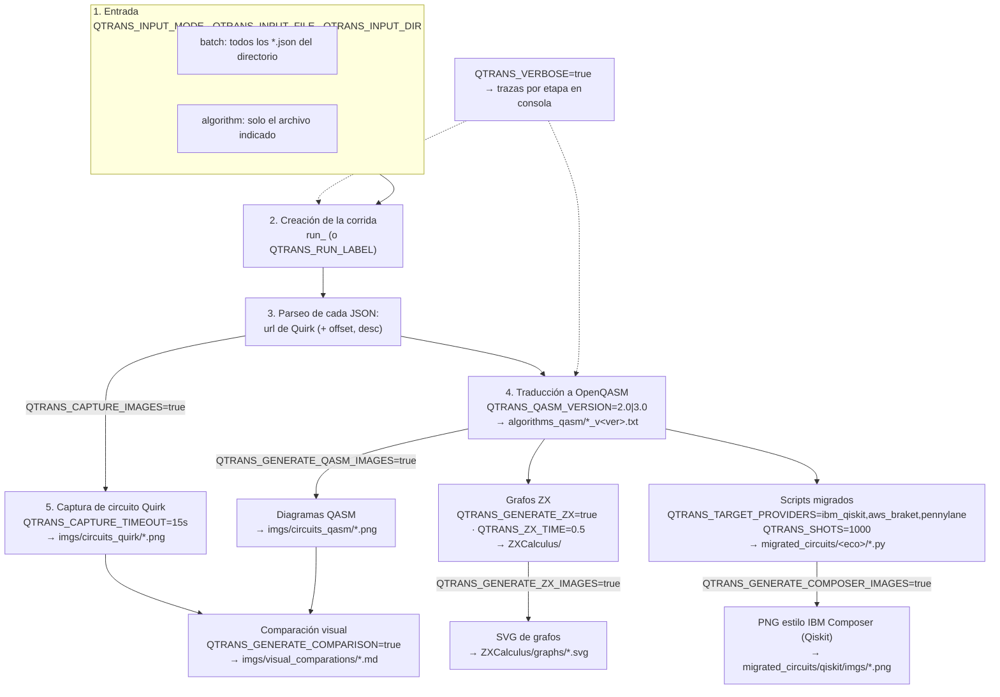

# QTransLIFIA

QTransLIFIA traduce circuitos cuánticos desde [Quirk](https://algassert.com/quirk) a cualquier ecosistema objetivo ([IBM Qiskit](https://www.ibm.com/quantum/qiskit), [AWS Braket](https://aws.amazon.com/braket/getting-started/) o [Pennylane](https://pennylane.ai/codebook/pennylane-fundamentals)) utilizando como lenguaje "pivote" de representación intermedia a [OpenQASM](https://openqasm.com/language/standard_library.html).

Desde la perspectiva de la **Ingeniería de Software Cuántica (QSE)**, QTransLIFIA se concibe con atributos de calidad explícitos: **abstracción** y **expresividad** (preservación semántica de las *custom gates* definidas en Quirk), **verificabilidad** y **testing** (equivalencia estructural y por cálculo ZX entre el circuito diseñado y el migrado, con estrategias de comprobación en cada etapa del flujo), y **escalabilidad** y **extensibilidad** (crecimiento hacia nuevos ecosistemas sin reescribir el núcleo). Estos seis atributos se documentan de forma individual y se recopilan en [**doc/QTransLIFIA_QSE.md**](doc/QTransLIFIA_QSE.md).

El proyecto ofrece **dos formas de ejecución**, independientes entre sí pero con el mismo flujo funcional y la misma estructura de salida:

| Modo | Punto de entrada | Entrada (default) | Salida (default) | Recomendado para |
| --- | --- | --- | --- | --- |
| **Librería Python** | `qtrans.py` (CLI + API) | `input/` | `output/run_DD_MM_YYYY__HH_MM/` | Automatización, scripts, integración en otros programas |
| **Cuaderno Jupyter** | `notebooks/QTrans.ipynb` | `notebooks/input/` | `notebooks/output/run_DD_MM_YYYY__HH/` | Exploración, visualización paso a paso y docencia |

Ambos modos comparten: lectura de JSON con URLs de Quirk, traducción a OpenQASM, capturas PNG, diagramas, comparaciones visuales, grafos ZX y generación de scripts migrados.

## Estructura del proyecto

```text
.
├── input/                                # JSON de entrada de la librería/CLI
├── output/                               # Corridas de la librería/CLI (no versionado)
│   └── run_DD_MM_YYYY__HH_MM/            # Una carpeta por corrida (fecha y hora con minutos)
├── notebooks/
│   ├── input/                            # JSON de entrada del cuaderno
│   ├── output/                           # Corridas del cuaderno (no versionado)
│   │   └── run_DD_MM_YYYY__HH/
│   └── QTrans.ipynb                        # Cuaderno con la lógica del pipeline
├── utils/
│   ├── __init__.py
│   ├── qutils.py                         # Traducción Quirk/OpenQASM, grafos ZX y captura
│   ├── main.py
│   ├── cleanup_outputs.py                # Limpieza de las corridas de salida
│   └── extract_urls.py
├── test/
│   ├── test_qtrans.py                    # Pruebas del pipeline/CLI
│   └── test_qasm.py                      # Pruebas de traducción OpenQASM
├── qtrans.py                             # API Python y CLI del pipeline
├── translator.py                         # API HTTP heredada
├── pyproject.toml                        # Empaquetado (pip install)
├── requirements.txt                      # Librerías requeridas
└── requirements_original.txt             # Librerías originales requeridas
```

### Salidas: directorio de corrida (`run_<estampa>`)

En **ambos modos** todas las salidas se agrupan bajo un único directorio de corrida, donde `<estampa>` codifica la fecha y la hora de inicio. La única diferencia es el formato de la estampa y la raíz:

- **Librería/CLI** → `output/run_DD_MM_YYYY__HH_MM/` (fecha y hora **con minutos**, p. ej. `run_10_10_2026__13_45`), configurable con `QTRANS_OUTPUT_DIR`. **Cada ejecución crea su propio directorio**, por lo que en `output/` solo quedan carpetas `run_*` (una por corrida).
- **Cuaderno** → `notebooks/output/run_DD_MM_YYYY__HH/` (fecha y hora **sin minutos**).

Dentro de la corrida la estructura es idéntica:

Dentro de la corrida la estructura es idéntica:

```text
run_<estampa>/
├── algorithms_qasm/            # OpenQASM traducido (*.txt con sufijo _v<ver>)
├── imgs/
│   ├── circuits_quirk/         # Capturas PNG de los circuitos Quirk originales
│   ├── circuits_qasm/          # Diagramas PNG de los circuitos OpenQASM
│   └── visual_comparations/    # Informes Markdown de comparación Quirk/QASM
├── migrated_circuits/          # Scripts Python migrados por ecosistema
│   ├── qiskit/
│   │   └── imgs/               # PNG estilo IBM Quantum Composer
│   ├── aws_braket/
│   └── pennylane/
└── ZXCalculus/                 # Equivalencia con cálculo ZX
    ├── algorithms_base/        # Grafos ZX construidos desde Quirk (*.json)
    ├── algorithms_qasm/        # Grafos ZX construidos desde OpenQASM (*.json)
    ├── graphs/                 # Diagramas SVG de los grafos
    └── comparison_results.csv  # Resultados de equivalencia
```

- Ejecutar el flujo varias veces **dentro de la misma hora** reutiliza el mismo directorio y **sobrescribe** los archivos generados, evitando crear una carpeta nueva por cada reintento.
- Al cambiar la hora se crea una nueva carpeta `run_*`, preservando el historial de corridas anteriores.
- Las carpetas generadas están excluidas del control de versiones (`.gitignore`: `/output/` y `/notebooks/output/`).

### Versión de OpenQASM

Tanto la librería/CLI como el cuaderno leen `QTRANS_QASM_VERSION` desde `.env` (`2.0` o `3.0`, defecto `3.0`). Cada archivo OpenQASM se escribe con el sufijo de versión, por ejemplo `1__Shor_v3.0.txt` o `1__Shor_v2.0.txt`, lo que permite que ambas versiones coexistan en la misma corrida. Las etapas posteriores (imágenes, grafos ZX y migración) procesan **solo** los `.txt` de la versión activa (filtran por el sufijo) y quitan el sufijo al derivar sus nombres, de modo que sus artefactos conservan el nombre sin versión.

## Instalación

Se recomienda Python 3.12, que es la versión usada en el entorno de desarrollo.

```bash
python -m venv .venv

# Windows PowerShell
.venv\Scripts\Activate.ps1
# macOS / Linux
source .venv/bin/activate

python -m pip install -r requirements.txt
```

Para capturar circuitos Quirk como PNG se necesita Chrome o Chromium disponible en el equipo. Selenium inicia el navegador en modo headless.

## Entrada: formato JSON

Coloca en el directorio de entrada (`input/` para la librería, `notebooks/input/` para el cuaderno) uno o más archivos `.json`. Cada archivo debe ser un objeto cuyas claves son nombres de algoritmos y cuyos valores incluyen una URL de Quirk:

```json
{
	"1. Ejemplo": {
		"url": "https://algassert.com/quirk#circuit=...",
		"offset": 0,
		"desc": "Descripción opcional"
	}
}
```

- `url` es obligatorio; `offset` y `desc` son opcionales.
- El modo batch procesa los JSON del **primer nivel** del directorio (no busca recursivamente).
- Si el nombre del archivo es `popular_algorithms.json`, los nombres de salida llevan el prefijo `popular_`.

## Configuración (`.env`)

Ambos modos cargan `.env` desde la raíz del proyecto (`load_dotenv()`). Plantilla base: `.env.example` (cópiala como `.env` para configuración local). Todas las rutas relativas se resuelven desde la raíz del proyecto.

```dotenv
QTRANS_INPUT_MODE=batch
QTRANS_INPUT_FILE=
QTRANS_INPUT_DIR=input
QTRANS_OUTPUT_DIR=output
QTRANS_RUN_LABEL=
QTRANS_CAPTURE_IMAGES=true
QTRANS_GENERATE_QASM_IMAGES=true
QTRANS_GENERATE_COMPARISON=true
QTRANS_GENERATE_COMPOSER_IMAGES=true
QTRANS_GENERATE_ZX=true
QTRANS_GENERATE_ZX_IMAGES=true
QTRANS_VERBOSE=true
QTRANS_QASM_VERSION=3.0
QTRANS_ZX_TIME=0.5
QTRANS_SHOTS=1000
QTRANS_CAPTURE_TIMEOUT=15
QTRANS_TARGET_PROVIDERS=ibm_qiskit
```

| Variable | Utilización | Default |
| --- | --- | --- |
| `QTRANS_INPUT_MODE` | `batch` procesa todos los JSON del directorio; `algorithm` procesa un solo archivo. | `batch` |
| `QTRANS_INPUT_FILE` | Archivo JSON seleccionado en modo `algorithm`; puede pasarse también por CLI. | |
| `QTRANS_INPUT_DIR` | Directorio de JSON de entrada. | `input` |
| `QTRANS_OUTPUT_DIR` | Raíz de las corridas (dentro se crea `run_<estampa>`). | `output` |
| `QTRANS_RUN_LABEL` | Etiqueta explícita de la corrida. Vacío = automático `DD_MM_YYYY__HH_MM`. | _(vacío)_ |
| `QTRANS_CAPTURE_IMAGES` | Activa capturas PNG de Quirk. Booleano (`true/false`, `yes/no`, `on/off`, `1/0`). | `true` |
| `QTRANS_GENERATE_QASM_IMAGES` | Activa diagramas PNG de los circuitos OpenQASM. Booleano. | `true` |
| `QTRANS_GENERATE_COMPARISON` | Activa informes Markdown de comparación Quirk/QASM. Booleano. | `true` |
| `QTRANS_GENERATE_COMPOSER_IMAGES` | Activa PNG de los circuitos migrados a Qiskit, con estilo IBM Quantum Composer. Booleano. | `true` |
| `QTRANS_GENERATE_ZX` | Activa conversión y comparación de grafos ZX. Booleano. | `true` |
| `QTRANS_GENERATE_ZX_IMAGES` | Activa diagramas SVG de los grafos ZX. Booleano. | `true` |
| `QTRANS_VERBOSE` | Muestra el resultado de cada etapa del pipeline. Booleano. | `true` |
| `QTRANS_QASM_VERSION` | Formato fuente generado: `2.0` o `3.0`. | `3.0` |
| `QTRANS_ZX_TIME` | Snapshot temporal Quirk para gates como `Rxft`, en el rango `0..1`. | `0.5` |
| `QTRANS_SHOTS` | Número de shots para los QNodes PennyLane con mediciones. Entero positivo. | `1000` |
| `QTRANS_CAPTURE_TIMEOUT` | Timeout de carga/captura del navegador Selenium, en segundos. Entero positivo. | `15` |
| `QTRANS_TARGET_PROVIDERS` | Lista separada por comas: `ibm_qiskit`, `aws_braket`, `pennylane`. | `ibm_qiskit` |

---

## Modo 1 — Ejecución como Librería Python (`qtrans.py`)

`qtrans.py` es el pipeline completo: se puede usar como **CLI** de línea de comandos o importar como **API** desde código Python.

### Instalación del paquete

`qtrans.py` está empaquetado con `pyproject.toml`, por lo que puede instalarse con `pip` (expone el comando `qtrans`, el módulo `qtrans`, `translator` y el paquete `utils`):

```bash
# Desde el repositorio (uso local)
pip install -e .

# o incluyendo extras opcionales
pip install -e ".[providers]"   # amazon-braket-sdk, pennylane
pip install -e ".[http]"        # Flask, Flask-Cors, Werkzeug
pip install -e ".[notebook]"    # jupyter, ipykernel, qiskit-aer
```

Extras disponibles: `providers`, `http`, `notebook`, `dev`.

### Uso como CLI

Ejecuta los comandos desde la raíz del repositorio (o usa el comando `qtrans` si instalaste el paquete).

Procesar todos los JSON de `QTRANS_INPUT_DIR`:

```bash
python qtrans.py --input-mode batch
```

Procesar un único JSON:

```bash
python qtrans.py --input-mode algorithm --input-file algorithms.json
```

Omitir las capturas PNG:

```bash
python qtrans.py --input-mode batch --no-capture
```

Forzar capturas aunque `.env` tenga `QTRANS_CAPTURE_IMAGES=false`:

```bash
python qtrans.py --input-mode batch --capture-images
```

Para consultar todos los argumentos:

```bash
python qtrans.py --help
```

| Argumento | Descripción |
| --- | --- |
| `--input-mode {batch,algorithm}` | Estrategia de entrada (default: `QTRANS_INPUT_MODE`). |
| `--input-file` | Archivo JSON en modo `algorithm`. Acepta nombre relativo a `--input-dir`, ruta relativa al CWD o ruta absoluta. |
| `--input-dir` | Directorio de JSON de entrada (default: `input`). |
| `--output-dir` | Raíz de las corridas; dentro se crea `run_<estampa>` (default: `output`). |
| `--run-label` | Etiqueta de la corrida (default: `DD_MM_YYYY__HH_MM`, fecha y hora con minutos). |
| `--qasm-version {2.0,3.0}` | Versión de OpenQASM generada (default: `3.0`). |
| `--providers` | Ecosistemas objetivo separados por comas: `ibm_qiskit`, `aws_braket`, `pennylane`. |
| `--shots` | Shots para los QNodes PennyLane (default: `1000`). |
| `--zx-time` | Snapshot temporal Quirk para gates como `Rxft`, rango `0..1` (default: `0.5`). |
| `--capture-timeout` | Timeout del navegador Selenium, en segundos (default: `15`). |
| `--capture-images` / `--no-capture` | Fuerza / omite las capturas PNG de Quirk. |
| `--no-qasm-images` | Omite los diagramas PNG de los circuitos OpenQASM. |
| `--no-comparison` | Omite los informes Markdown de comparación visual. |
| `--no-composer-images` | Omite las imágenes estilo IBM Quantum Composer. |
| `--no-zx` | Omite la conversión y comparación de grafos ZX. |
| `--no-zx-images` | Omite los diagramas SVG de los grafos ZX. |
| `--verbose` / `--quiet` | Activa / silencia las trazas por etapa. El log **está activado por defecto** (equivale a `QTRANS_VERBOSE=true`). |

### Uso como API

`qtrans.py` expone `run_pipeline`, que ejecuta el flujo completo y devuelve un resumen:

```python
from qtrans import run_pipeline

batch_result = run_pipeline(input_mode="batch")
single_result = run_pipeline(
    input_mode="algorithm",
    input_file="algorithms.json",
    capture_images=False,
)
```

Parámetros principales de `run_pipeline`:

| Parámetro | Descripción |
| --- | --- |
| `input_mode`, `input_file`, `input_dir` | Entrada (equivalentes a las opciones del CLI). |
| `output_dir`, `run_label`, `run_dir` | Raíz de la corrida, etiqueta y directorio explícito de corrida. |
| `qasm_version`, `target_providers`, `shots`, `zx_time` | Configuración funcional. |
| `capture_images`, `generate_qasm_images`, `generate_comparison`, `generate_composer_images`, `generate_zx`, `generate_zx_images` | Interruptores por etapa (`None` = tomar el valor del `.env`). |
| `qasm_dir`, `quirk_images_dir`, `qasm_images_dir`, `compare_dir`, `zx_dir`, `migrated_dir`, `composer_images_dir` | Sobrescriben las rutas derivadas de la corrida. |
| `verbose`, `capture_timeout` | Diagnóstico y timeout de captura. |

El resumen devuelto incluye, entre otros: `input_mode`, `qasm_version`, `target_providers`, `run_dir`, `files_processed`, `algorithms_processed`, `qasm_generated`, `captures_succeeded`, `captures_failed`, `qasm_images_generated`, `comparison_docs_generated`, `composer_images_generated`, `zx_base_graphs_generated`, `zx_qasm_graphs_generated`, `zx_comparisons`, `zx_images_generated`, `provider_scripts_generated`, `output_directories` y `errors`.

### Salida

OpenQASM (según `QTRANS_QASM_VERSION`) en `output/run_<estampa>/algorithms_qasm/` y, cuando las etapas están activas, capturas PNG, diagramas, comparaciones, grafos ZX y scripts migrados, siguiendo la estructura de corrida descrita arriba. Los errores de captura o de cualquier etapa se contabilizan y **no cancelan** las demás generaciones.

---

## Modo 2 — Ejecución con Cuadernos Jupyter

Los cuadernos se conservan como flujo alternativo e independiente de la librería. Abre `notebooks/QTrans.ipynb`, selecciona un kernel con las dependencias instaladas y ejecuta las celdas en orden. La primera celda verifica e instala los paquetes necesarios en el kernel.

### Flujo del cuaderno

El cuaderno principal lee `notebooks/input/algorithms.json` y `notebooks/input/popular_algorithms.json` y escribe todas sus salidas bajo una única carpeta de corrida `notebooks/output/run_DD_MM_YYYY__HH/`. La estructura de carpetas se crea de forma **perezosa**: cada celda crea, bajo demanda, el directorio que necesita o genera, en lugar de crear todo el árbol al inicio:

- `algorithms_qasm/` — QASM traducido (lo crea la celda de generación de QASM).
- `imgs/circuits_quirk/` y `imgs/circuits_qasm/` — diagramas PNG.
- `imgs/visual_comparations/` — informes Markdown de comparación visual.
- `ZXCalculus/{algorithms_base,algorithms_qasm,graphs}/` — grafos ZX y SVG.
- `migrated_circuits/qiskit/`, `migrated_circuits/aws_braket/`, `migrated_circuits/pennylane/` — scripts migrados.
- `migrated_circuits/qiskit/imgs/` — imágenes `.png` de cada circuito migrado a Qiskit, renderizadas con el estilo de IBM Quantum Composer (`circuit.draw(output='mpl', style='iqp')`).

Cada celda imprime en su log el directorio de la corrida (`DIRECTORIO DE LA CORRIDA: ...`) para ubicar los artefactos. Las celdas de migración leen los archivos OpenQASM de la carpeta `algorithms_qasm/` de esa misma corrida.

Los scripts Braket requieren `amazon-braket-sdk`; los scripts PennyLane requieren `pennylane`.

---

## Limpieza de salidas (`utils/cleanup_outputs.py`)

Elimina los directorios de corrida (`run_*`) generados por la librería/CLI (`output/`) y por el cuaderno (`notebooks/output/`). Funciona como script de consola o como biblioteca importable.

```bash
# Ver qué se eliminaría, sin borrar nada
python utils/cleanup_outputs.py --dry-run

# Borrar las corridas de ambas raíces (pide confirmación)
python utils/cleanup_outputs.py

# Sin confirmación
python utils/cleanup_outputs.py -y

# Limpiar solo output/ (ignora notebooks/output/)
python utils/cleanup_outputs.py --root output -y
```

| Argumento | Descripción |
| --- | --- |
| `--root PATH` | Directorio de salida a limpiar (repetible). Al indicarlo se reemplazan los defaults (`output/`, `notebooks/output/`). |
| `--all` | Elimina también los archivos sueltos presentes en los directorios de salida. |
| `--keep N` | Conserva las `N` corridas más recientes de cada directorio (default: `0`). |
| `--remove-roots` | Elimina también el directorio raíz cuando queda vacío. |
| `-n`, `--dry-run` | Muestra qué se eliminaría sin borrar nada. |
| `-y`, `--yes` | No pide confirmación. |
| `-q`, `--quiet` | Salida reducida. |

Uso como biblioteca:

```python
from utils.cleanup_outputs import clean_outputs

summary = clean_outputs(roots=["output"], assume_yes=True)
print(summary["total_bytes"])
```

---

## Flujo de ejecución (pipeline)

Pipeline común a ambos modos, indicando qué genera cada parametrización:



Resumen de generaciones activables por parámetro:

| Parámetro | Valor | Artefacto generado |
| --- | --- | --- |
| `QTRANS_QASM_VERSION` | `2.0` / `3.0` | Código OpenQASM en `algorithms_qasm/` |
| `QTRANS_CAPTURE_IMAGES` | `true/false` | PNG de Quirk en `imgs/circuits_quirk/` |
| `QTRANS_GENERATE_QASM_IMAGES` | `true/false` | PNG de circuitos QASM en `imgs/circuits_qasm/` |
| `QTRANS_GENERATE_COMPARISON` | `true/false` | Informes `.md` en `imgs/visual_comparations/` |
| `QTRANS_GENERATE_ZX` | `true/false` | Grafos ZX y análisis en `ZXCalculus/` |
| `QTRANS_GENERATE_ZX_IMAGES` | `true/false` | SVG de grafos ZX en `ZXCalculus/graphs/` |
| `QTRANS_TARGET_PROVIDERS` | `ibm_qiskit`, `aws_braket`, `pennylane` | Scripts Python en `migrated_circuits/<eco>/` |
| `QTRANS_GENERATE_COMPOSER_IMAGES` | `true/false` | PNG estilo IBM Composer en `migrated_circuits/qiskit/imgs/` |

## Migración a ecosistemas objetivo

Los scripts migrados se generan en Python ejecutable, uno por algoritmo y ecosistema:

- **IBM Qiskit** (`migrated_circuits/qiskit/`): usa puertas nativas (`h`, `x`, `y`, `z`, `s`, `sdg`, `t`, `tdg`, `sx`, `id`, `cx`, ...) en lugar de `circuit.u(...)` siempre que el `u1/u2/u3` corresponda a una puerta estándar. Produce además las imágenes estilo IBM Quantum Composer en `imgs/`.
- **AWS Braket** (`migrated_circuits/aws_braket/`): requiere `amazon-braket-sdk`.
- **PennyLane** (`migrated_circuits/pennylane/`): QNodes con `QTRANS_SHOTS` shots; requiere `pennylane`.

## API HTTP heredada

`translator.py` conserva la API Flask usada por las integraciones existentes. Se inicia con:

```bash
python translator.py
```

El servidor escucha en `http://localhost:8081`. Endpoints POST disponibles:

- `/code/ibm` y `/code/ibm/individual`
- `/code/aws` y `/code/aws/individual`
- `/code/qasm` y `/code/qasm/individual`

La colección de Postman está en `postman/Quirk_Translator_IBM_AWS.postman_collection_original.json`.

## Pruebas

Ejecuta la suite del proyecto con:

```bash
python -m unittest discover -s test -p "test_*.py" -v
```
